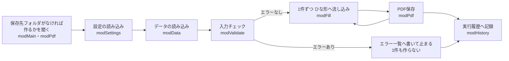

# 引き継ぎメモ(直す人向け)

このツールを直す・広げる人のためのメモです。使い方は [手順書](手順書.md) にあります。
読む人によって、読むところが違います。

| あなたは | 読むところ |
|---|---|
| ブック(.xlsm)だけを受け取って、使いながら直す | [第1部 ブックだけで直す人へ](#第1部-ブックだけで直す人へ) |
| このリポジトリ(src/・tools/・tests/)で開発を続ける | 第1部を読んだあと、[第2部 このリポジトリで開発する人へ](#第2部-このリポジトリで開発する人へ) |

## 第1部 ブックだけで直す人へ

ブックの中の VBA を VBA エディターで直して、ブックを保存すれば済みます。ほかの道具は要りません。

### 1. 直すときの手順

1. **控えを取る**:直す前にブックをコピーしておきます(うまくいかなかったら、控えに戻せます)。
2. **直す**:設定やひな形で済むことは、コードを開かずにシートで直せます(5. の表)。コードを直すときは、Alt+F11 で VBA エディターを開きます。
3. **書き間違いがないか確かめる**:VBA エディターの [デバッグ] → [VBAProject のコンパイル]。何も出なければ大丈夫です。
4. **保存する**:Excel に戻って上書き保存します(形式は .xlsm のまま)。
5. **動きを確かめる**:
   - [入力をチェック] で、いつものデータが「エラーはありません」になること。
   - [1件だけひな形に表示] で、請求書の見た目と金額が正しいこと。
   - PDFまで確かめるときは、設定の保存先を試し用のフォルダにしてから [PDFを作成] を押す。
   - チェックを直したときは、わざと誤ったデータ(空の欄、5% の税率 など)を入れて、エラー一覧に出ることを確かめる。`請求書一括PDF作成_エラー確認用.xlsm` は別のブックなので、直したコードは入っていません。

### 2. マクロの流れ



- 入口はボタンから呼ぶ `modMain` の3つのマクロです。流れの本体は `modMain.ExecuteBatch` です。
- **メッセージを出すのは `modMain` の `Run...` だけ**です。`ExecuteBatch` と `ExecutePreview` は画面を出さずに結果の文章を返すので、ほかのマクロからも呼べます(第2部のテストも、これを `Application.Run` で呼んでいます)。PDF作成前の確認メッセージだけは、`ExecuteBatch` の引数 `askBeforeCreate` が True のときに出します。
- **保存先フォルダがないとき**は、`RunCheckOnly` と `RunCreatePdfs` が `ExecuteBatch` の前に、`OfferToCreateFolder` で「このフォルダを作りますか?」と聞きます。聞くかどうかを決める `OutputFolderToCreate`(1つ上のフォルダがあるときだけ聞く)と、作る `modPdf.CreateFolder`(最後の1階層だけ作る)は、画面を出しません。[いいえ] のときや作れなかったときは、そのまま `ExecuteBatch` の入力チェックがエラー一覧に出して止めます。
- 想定外のエラーは `ExecuteBatch` の `Failed:` で受け止め、`stage`(段階)と `currentNo`(請求番号)を画面の文と実行履歴に書きます。

### 3. モジュール

| モジュール | 役割 | 主な手続き |
|---|---|---|
| modMain | 入口と全体の流れ | `RunCheckOnly` `RunCreatePdfs` `RunPreview`(ボタン)、`ExecuteBatch` `ExecutePreview`(本体)、`OutputFolderToCreate`(作るかを聞く保存先フォルダ) |
| modConstants | 決め打ちの値 | 見出し名、設定の項目名、選べる値、ひな形の名前、税率など |
| modSettings | 設定の読み込み | `LoadSettings`(設定シート → `AppSettings`)、`SettingRow`、`ResolveFolder`(相対パス → フルパス) |
| modData | 請求一覧・明細の読み込み | `ReadInvoices` `ReadDetails`、`HeaderColumn` `LastValueRow`、`CellText` `IsNumberValue` `IsDateValue` |
| modValidate | 入力チェックとエラー一覧 | `ValidateAll`、`CheckInvoice` `CheckDetail`、`WriteErrorList`、`AddError` |
| modFill | ひな形への流し込み | `CheckTemplate`(表示されているか・名前がそろっているか)、`FillInvoice` `ClearTemplate`、`FindSheet` |
| modPdf | ファイル名とPDF保存 | `BuildFileName` `UnknownTag` `HasInvalidFileChar`、`ExportPdf`、`FileExists` `FolderExists`、`CanCreateFolder` `CreateFolder`(保存先フォルダを作る) |
| modHistory | 実行履歴 | `AppendHistory` |
| clsInvoice | 請求1件(請求一覧の1行 + 明細) | `Details`(明細の集まり)、`FileName` |
| clsDetail | 明細1行 | |
| clsCheckError | エラー1件(エラー一覧の1行) | |

### 4. シートとコード名

VBA からは、シートを**コード名**で指します。タブの名前(表示名)を変えてもコードは動きます。

| 表示名 | コード名 | メモ |
|---|---|---|
| 使い方 | shUsage | ボタン3つ(図形に `modMain.Run...` を登録) |
| 設定 | shSettings | A列:項目、B列:値、C列:説明 |
| 請求一覧 | shInvoices | 1行目が見出し(テーブル `T_請求一覧`) |
| 明細 | shDetails | 1行目が見出し(テーブル `T_明細`) |
| 請求書ひな形 | shTemplate | コードはコード名では指さず、設定の「ひな形シート名」で探す |
| エラー一覧 | shErrors | 2行目:結果の一文、5行目から:エラー |
| 実行履歴 | shHistory | 4行目から:1回の実行が1行 |

シートを消して作り直すとコード名が変わり、コードが動かなくなります。シートは消さずに中身を直してください。

### 5. どこを直せば何が変わるか

| やりたいこと | 直す場所 | コードを直す? |
|---|---|---|
| 自社情報・保存先・ファイル名・同名ファイルの扱い・端数処理を変える | 「設定」シートのB列 | いいえ |
| 保存先フォルダがないときに、作るかを聞かずに止めるだけにする | `modMain` の `RunCheckOnly` と `RunCreatePdfs` から、`OfferToCreateFolder` の行を消す | はい |
| 請求書のレイアウト・文言・ロゴを変える | 「請求書ひな形」シート。差し込み先のセルにつけた**名前**(`差込_請求番号` など、数式タブ → 名前の管理)は消さない。セルを動かしても名前はついてくる | いいえ |
| ひな形を何種類か使い分ける | ひな形シートをコピーし、設定の「ひな形シート名」を変える(名前はシートごとにコピーされる) | いいえ |
| 明細の行数を増やす | ひな形の明細欄の**途中**(最後の行より上)に行を挿入し、金額(F列)の式を新しい行にもコピーする。途中に挿入すれば、4つの名前(`差込_品名` `差込_数量` `差込_単価` `差込_税率`)と小計の式(`SUMIF`)の範囲は自動で広がる(名前の管理で確かめる) | いいえ |
| 請求一覧・明細の列の順番を変える | シートで列を入れ替えるだけ(見出しの文字で列を探す) | いいえ |
| 見出しの文字・設定の項目名を変える | シートと `modConstants`(`COL_...` `SET_...`)の両方 | はい(定数だけ) |
| ファイル名の差し込みを足す(例:{支払期限}) | `modConstants` に `TAG_...`、`modPdf` の `BuildFileName` と `UnknownTag` | はい |
| 設定を1つ足す | 設定シートに行、`modConstants` に `SET_...`、`modSettings` の `AppSettings` と `LoadSettings` | はい |
| チェックを足す | `modValidate` の合う `Check...` に `AddError` を1つ。メッセージには「何が問題か」と「どう直すか」を書く | はい |
| 税率を足す・変える | `modConstants` の `TAX_RATE_...`、`modValidate` の `NormalizeTaxRate`、ひな形の小計・消費税の行と式 | はい |
| エラー一覧・実行履歴の列を変える | `modValidate` の `WriteErrorList`、`modHistory` の `AppendHistory`、`modConstants` の `ERROR_...` `HISTORY_...` | はい |

### 6. コードの決めごと

- すべてのモジュールに `Option Explicit`。決め打ちの値は `modConstants` か「設定」シートに置く。
- コメントは日本語で、「何のために」を書く。
- 画面(MsgBox・InputBox・シートの切り替え)を出すのは `modMain` の `Run...` だけ。ほかの手続きは画面を出さない。
- 入力の誤りは例外にせず、`AddError` で集めて「エラー一覧」に出す。例外(`Err.Raise`)は、想定外のこと(PDFが書けない など)だけ。
- 外とつながるもの(ネット通信、外部サービス、アドイン、外部ライブラリの参照)は使わない。使っている部品は Excel と Windows に最初から入っているものだけ(`Scripting.Dictionary` は Windows 標準)。
- **ThisWorkbook とシートのモジュール**:ブックだけで使い続けるなら、イベント(ブックを開いたとき など)のコードを書いてかまいません。ただし、このリポジトリの組み立て(第2部)ではこれらのモジュールを空で作るので、直したブックを開発元に渡して取り込んでもらうときは、そこにコードを書いたことを伝えてください。

### 7. 知っておくと助かること

- **ブックが OneDrive の上にあるとき**、`ThisWorkbook.Path` は `https://...` になります。相対パスの保存先は使えないので、エラーにしてフルパスを求めています(`modSettings.ResolveFolder`)。
- **保存先フォルダを作るのは、最後の1階層だけ**です。`modPdf.CreateFolder` は、1つ上のフォルダがあるとき(`CanCreateFolder`)だけ `MkDir` を呼びます。ネットワークの共有フォルダ(`\\サーバー\共有\…`)では `\\サーバー\共有` を1つ上のフォルダとして扱い、`\\サーバー` だけではフォルダと見なしません(作ったときに、このPCの共有 `\\localhost\C$` で確かめた。ほかのPCの共有フォルダでは試していません)。
- **最後の行は `modData.LastValueRow` で探しています**(使っている範囲の値をまとめて読み、下から探す)。`End(xlUp)` は、テーブルのフィルターなら隠れた行も数えますが、テーブルでない範囲のフィルター(実行履歴など)では隠れた行を飛ばします。`Find`(`SearchDirection:=xlPrevious`)も隠れた行を探しません。どちらも読み落としや、隠れた行への上書きにつながるので使っていません(作ったときに Microsoft 365 の Excel で確かめた)。
- **PDFの保存先とファイル名は、合わせて 255 文字まで**です。256 文字以上は `ExportAsFixedFormat` が失敗するので、入力チェックで止めています(`MAX_PATH_LENGTH`。作ったときに Microsoft 365 の Excel で確かめた値)。
- **非表示のシートはPDFにできません**(`ExportAsFixedFormat` が失敗する)。ひな形が非表示なら、入力チェックで止めています(`modFill.CheckTemplate`)。
- **保護したひな形**:差し込み先のセル(名前をつけたセル)のロックを外してから保護するのはかまいません。ロックしたまま保護すると、1件目の流し込みで「保護されている」と止まります(その時点ではPDFはまだ作られていません)。
- **PDFの作成者情報**:`ExportAsFixedFormat` に `IncludeDocProperties:=False` を渡し、ブックの作成者名などをPDFに入れていません。
- **計算方法が「手動」でも**、流し込みのあとに `ws.Calculate` で計算してからPDFにしています。
- **税率の比較**:セルの 10% は 0.1 という小数です。チェックのときに 0.1 / 0.08 ちょうどにそろえ、ひな形の `SUMIF` が税率ごとに合計できるようにしています。消費税の式は `小計*10/100` の形にして、小数の誤差で切り上げが1円ずれないようにしています。

## 第2部 このリポジトリで開発する人へ

このリポジトリでは、**`src/` の .bas / .cls が正本**です。`.xlsm` はソースとデータから組み立てるもので、直接直しません。第1部の中身(モジュール、どこを直せば何が変わるか など)は、そのまま当てはまります。ただし、ThisWorkbook とシートのモジュールの扱いだけは、この部の 3. の決まりに従ってください。

### 1. ソースと .xlsm の関係

- `.xlsm` は `tools\build.ps1` が、`src\` のソースと `testdata\` のデータから組み立てます。
- 組み立ての手順:
  1. Excel を自動操作して、シート・書式・ひな形・データを作り、`.xlsx` に保存(`tools\build.ps1`)
  2. `src\` から `vbaProject.bin` を作って入れ、`.xlsm` にする(`tools\VbaProjectWriter.cs`)
  3. Excel で開いてボタンをつけ、作成者名を残さない設定にして保存
- 2. は、ファイル形式の仕様([MS-OVBA]・[MS-CFB])どおりに VBA のソースを入れています。コンパイルは、Excel がブックを開いてマクロを動かすときに行います。このため、Excel の「VBA プロジェクト オブジェクト モデルへのアクセスを信頼する」を**オンにしなくても**組み立てられます。
- 組み立てに要るもの:Windows、デスクトップ版の Excel、Windows PowerShell 5.1(Windows に標準)。

```powershell
powershell -NoProfile -ExecutionPolicy Bypass -File tools\build.ps1
powershell -NoProfile -ExecutionPolicy Bypass -File tests\run-tests.ps1
```

`-ExecutionPolicy Bypass` は、その1回の起動だけに効く指定です(PCの設定は変えません)。

### 2. 直し方

どちらの方法でも、最後に `src\` を正本としてそろえ、組み立て直してテストを通します。

- **ソースを直して組み立て直す**(おすすめ):`src\` を直し、`build.ps1` → `run-tests.ps1`。
- **VBA エディターで直す**:直したモジュールを右クリック → [ファイルのエクスポート] で `src\` に上書きし、`build.ps1` で組み立て直して `run-tests.ps1` を通す。

### 3. ThisWorkbook とシートのモジュールにはコードを書かない

このリポジトリでは、**シートのモジュール(shSettings など)と ThisWorkbook にコードを書きません。** 組み立てではこれらを空のモジュールとして作るため、書いたコードは残りません(`src\` に `ThisWorkbook.cls` などを置くと、`build.ps1` がエラーで止まって知らせます)。

イベント(ブックを開いたとき など)が要るときは、`tools\build.ps1` と `tools\VbaProjectWriter.cs` の `DocumentModule` を直して、文書モジュールのコードも組み立てられるようにしてください。第1部の人から、ThisWorkbook などにコードを書いたブックを受け取ったときも同じです。

### 4. 文字コード

- `.bas` / `.cls` は、**リポジトリ(GitHub)では UTF-8、作業フォルダでは Shift_JIS(CP932)と CRLF** です(`.gitattributes` の `working-tree-encoding`)。VBA エディターの取り込み・書き出しは Shift_JIS なので、そのまま使えます。
- `tools\build.ps1` は UTF-8 と Shift_JIS のどちらのソースも読めます。
- `.ps1` は BOM つき UTF-8 です(Windows PowerShell 5.1 が日本語を正しく読むため)。

### 5. テスト

`tests\run-tests.ps1` は、リポジトリの `.xlsm` を一時フォルダにコピーして、次のことを確かめます(リポジトリのファイルは変えません)。

- エラー確認用のデータで、`tests\expected-errors.csv` のとおりのエラーが、その順番で出る
- 正常なデータでエラーが出ない。20件のPDFができ、ファイル名がルールどおりで、どれも1ページ
- ひな形の小計・消費税・合計が、CSV から計算した値と合う(端数処理の3つの設定すべて、20件)
- エラーが1件でもあれば、1件も作らない
- 同名ファイル:「止める」で止まり1件も書き換えない/「上書き」で作り直す
- 想定外のエラー(PDFを開いたまま上書き)で、止まった請求番号と作成件数が画面の文と実行履歴に出る
- 設定の誤り(差し込み・登録番号・端数処理・同名ファイル)を指摘する。相対パスをブックの場所から探す
- 保存先フォルダがないとき:1つ上のフォルダがあれば作るかを聞く対象になり、[いいえ] ならエラー一覧に出して止まり、[はい] なら最後の1階層だけ作って続く。1つ上もない(途中のフォルダがない・このPCにないドライブ)ときは、聞かず・作らずに止める。作れないときは、止まらずに理由を返す(聞く画面そのものは、テストでは出さないので手で確かめる)
- ひな形をコピーしたシートを設定で選べる。明細欄の途中に行を挿入すると、13行の請求が通る
- 実行履歴が、閉じて開き直しても残る
- フィルターで行を隠しても、請求一覧を読み落とさない・実行履歴の隠れた行を上書きしない
- エラー値(#N/A)・文字として入った数字・非表示のひな形・255 文字を超えるパス・データなし を、作る前に止める
- 差し込み先のセルのロックを外せば、ひな形を保護しても全件PDFにできる。顧客名を式で出しても、その結果が請求書に出る
- 配るブックに作成者名が残っていない、ひな形が空、ボタンにマクロがついている、敬称を選べる

エラー確認用のデータやチェックを変えたら、`tests\expected-errors.csv` も直します。
`docs\見本\` のPDFは、`run-tests.ps1 -SampleDir docs\見本` で作り直せます(テストがすべて通ったときだけ置きます)。

### 6. 組み立てで気づいたこと

`tools\build.ps1` を直すときに知っておくと助かることです。

- 日本語版の Excel では、表示形式に `"General"` を指定できません(指定しなければ標準のままです)。
- 結合したセルを何行もまたいで、配置の設定(縮小して全体を表示 など)を一度にすると、Excel がまとめて1つに結合します。行ごとに設定しています。
- Windows PowerShell 5.1 から COM に、同じ行で型の違う値を渡すと型の変換で失敗することがあります。値を渡す呼び出しは `tools\ExcelSession.ps1` の `[BatchInvoicePdf.Build.Com]` を通しています。
